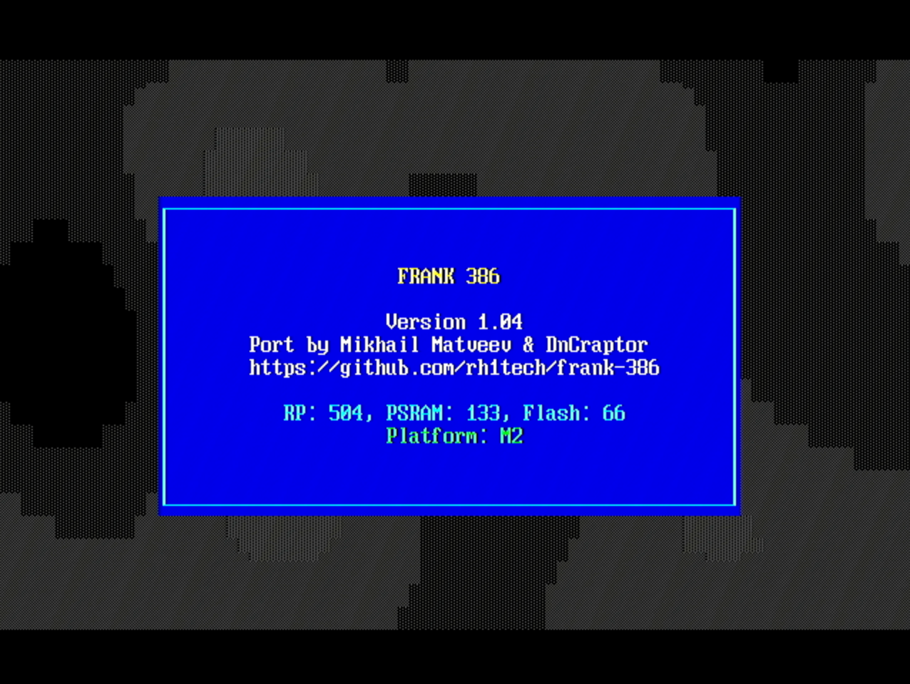
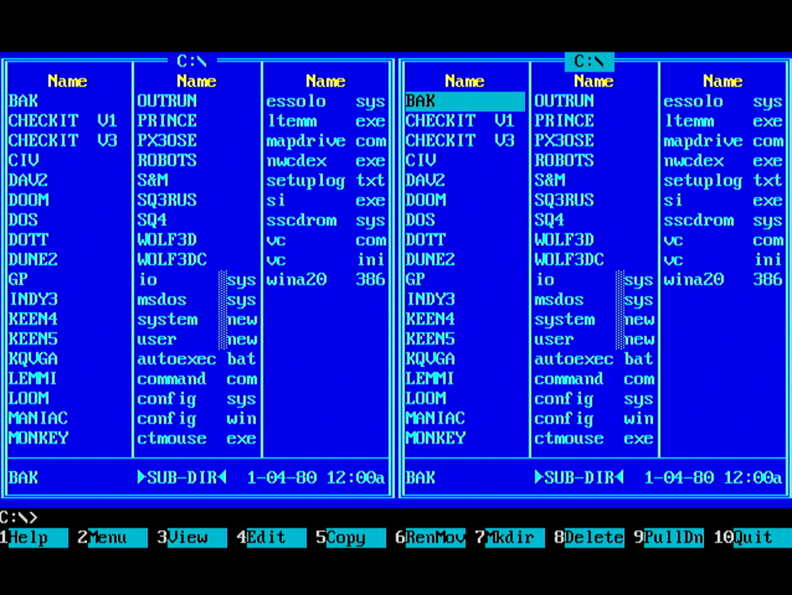
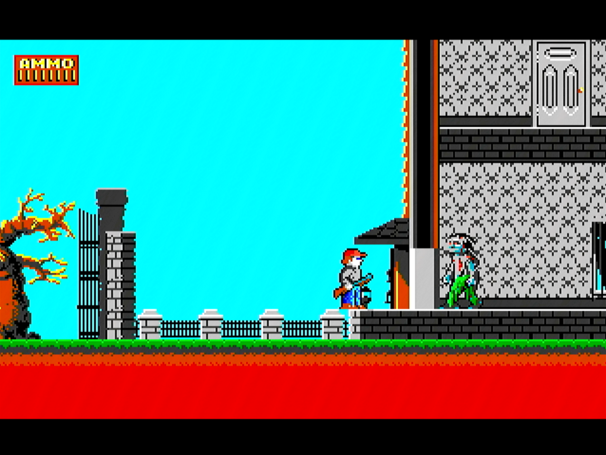
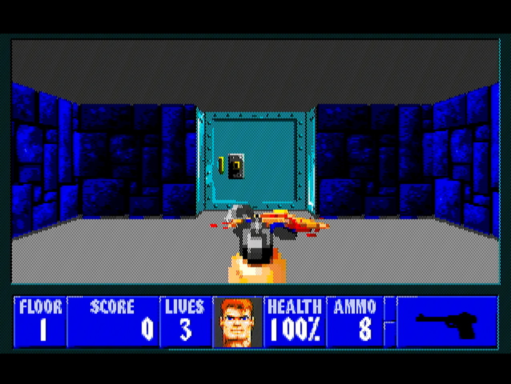
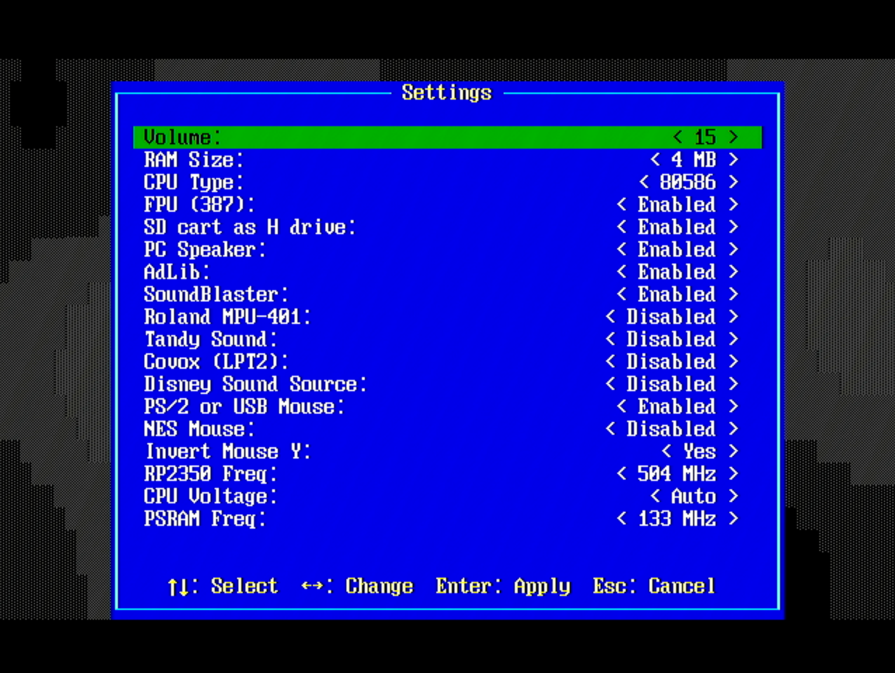

# FRANK 386

Official page: **[frank.rh1.tech](https://frank.rh1.tech/)** — hub for all FRANK boards and firmware.

i386 PC Emulator for RP2350 (Raspberry Pi Pico 2) with VGA/HDMI output, SD card storage, PS/2 and USB keyboard/mouse, NES gamepad, and audio output.

Based on [Tiny386](https://github.com/hchunhui/tiny386) by Chunhui He.

## Features

- Full i386 (and partially i486/i586) CPU emulation with optional x87 FPU
- Up to 8MB RAM (using 8MB PSRAM)
- VGA and HDMI graphics output (text modes and graphics up to 640x480)
- HDMI output is real HDMI (not DVI): data islands, AVI/audio InfoFrames and 44.1 kHz stereo audio, so it works with USB HDMI capture cards as well as monitors and TVs
- Sound: AdLib OPL2, Sound Blaster 16, PC Speaker, Tandy, Covox, Disney Sound Source (over I2S/PWM, and over HDMI when HDMI is the output)
- SD card support for floppy, hard disk, and CD-ROM images
- Runtime disk manager (Win+F12) for hot-swapping disk images
- Settings menu (Win+F11) for changing emulator configuration
- PS/2 keyboard and mouse input
- USB keyboard and mouse input (via native USB Host)
- NES gamepad support with mouse emulation mode
- Boots DOS, Windows 3.x, **Windows 95**, Linux, and more

## Screenshots

### FRANK 386 in Action







## Supported Boards

This firmware is designed for RP2350-based boards with integrated VGA/HDMI, SD card, and keyboard input:

- **[FRANK](https://rh1.tech/projects/frank?area=about)** - A versatile development board with VGA output
- **[Murmulator](https://murmulator.ru)** - A compact retro-computing platform based on RP Pico 2 (M1 and M2 variants)
- **[Olimex PICO-PC](https://www.olimex.com/)** - Olimex RP2350 PC board
- **[Waveshare RP2350-PiZero](https://www.waveshare.com/)** - Waveshare RP2350 board

## Hardware Requirements

- **Raspberry Pi Pico 2** (RP2350) or compatible board
- **8MB QSPI PSRAM** on the RP2350's second QSPI chip select (XIP CS1: GPIO47 on RP2350B, GPIO19 or GPIO8 on RP2350A), sharing the bus with the flash. PSRAM wired as a plain SPI device on other GPIOs is not supported.
- **VGA or HDMI connector**
- **SD card module** (SPI mode)
- **PS/2 keyboard** (directly connected) - OR - **USB keyboard** (via native USB port)
- **Audio output** (optional): I2S DAC or PWM

> **Note:** When USB HID is enabled on the native USB port, that port is used for keyboard/mouse input and the USB serial console (CDC) is disabled; use UART for debug output. On Z2 a USB HID build puts a UART console on GPIO0 (TX) / GPIO1 (RX) at 115200 baud and drops PS/2 support, because the Z2 PS/2 mouse uses those pins.

> **Z2 USB ports:** USB HID builds for Z2 run the USB host on the board's **PIO-USB** USB-C socket (GPIO28/29, via [Pico-PIO-USB](https://github.com/sekigon-gonnoc/Pico-PIO-USB)); plug the keyboard, mouse or a hub there. The native **USB** socket is then a USB serial console (CDC), alongside the UART one: TinyUSB runs as a host on PIO-USB and as a device on the native port at the same time. Build with `-DZ2_PIO_USB=OFF` to use the native socket for the host instead (no USB console then).

> **Non-Winbond flash (e.g. Puya on some Waveshare RP2350-PiZero batches):** these chips can ship with the flash Quad Enable bit cleared, which makes PSRAM boards fail once overclocked. The firmware checks the bit on every boot and sets it once if needed, so no separate `FLASH_QE_SET_1.uf2` step is required.

## Board Configurations

Four GPIO layouts are supported: **M1**, **M2**, **PC** (Olimex), and **Z2** (Waveshare).

### VGA / HDMI
| Signal | M1 GPIO | M2 GPIO |
|--------|---------|---------|
| Base   | 6       | 12      |
| Range  | 6-13    | 12-19   |

### SD Card (SPI mode)
| Signal  | M1 GPIO | M2 GPIO |
|---------|---------|---------|
| CLK     | 2       | 6       |
| CMD     | 3       | 7       |
| DAT0    | 4       | 4       |
| DAT3/CS | 5       | 5       |

### PS/2 Keyboard
| Signal | M1 GPIO | M2 GPIO |
|--------|---------|---------|
| CLK    | 0       | 2       |
| DATA   | 1       | 3       |

### PS/2 Mouse
| Signal | M1 GPIO | M2 GPIO |
|--------|---------|---------|
| CLK    | 14      | 0       |
| DATA   | 15      | 1       |

### NES/SNES Gamepad
| Signal | M1 GPIO | M2 GPIO |
|--------|---------|---------|
| CLK    | 14      | 20      |
| DATA   | 16      | 26      |
| LATCH  | 15      | 21      |

### I2S Audio
| Signal | M1 GPIO | M2 GPIO |
|--------|---------|---------|
| DATA   | 26      | 9       |
| BCLK   | 27      | 10      |
| LRCLK  | 28      | 11      |

## SD Card Setup

### Directory Structure

Create a `386/` directory on your SD card:

```
SD Card Root/
└── 386/
    ├── config.ini      # Configuration file
    ├── bios.bin        # SeaBIOS ROM (required)
    ├── vgabios.bin     # VGA BIOS ROM (required)
    ├── dos622.img      # Hard disk image
    ├── boot.img        # Floppy image
    └── ...             # Other disk images
```

### BIOS Files

Download SeaBIOS and VGA BIOS from the [SeaBIOS releases](https://www.seabios.org/downloads/) or use bios.bin/vgabios.bin from `sdcard/386`.

### Configuration File (config.ini)

Create `386/config.ini`:

```ini
[pc]
mem=8M
bios=bios.bin
vga_bios=vgabios.bin

[frank-386]
cpu_freq=504
psram_freq=166
```

### Preparing Disk Images

**Floppy Images (.img):**
- Standard 1.44MB floppy images (1474560 bytes)
- Create with: `dd if=/dev/zero of=floppy.img bs=512 count=2880`
- Format with DOS or use pre-made DOS boot disks

**Hard Disk Images (.img):**
- Raw disk images up to 2GB
- Create with: `dd if=/dev/zero of=hdd.img bs=1M count=512`
- Use FDISK and FORMAT from DOS to partition and format

**CD-ROM Images (.iso):**
- Standard ISO 9660 images
- Use CD burning software to create ISOs from CDs

### Loading Disk Images

**At Boot:**
Configure disk images in `config.ini` as shown above.

**At Runtime (Disk Manager):**
1. Press **Win+F12** to open the Disk Manager
2. Use arrow keys to select a drive (A:, B:, C:, D:, E:)
3. Press **Enter** to browse disk images in the `386/` directory
4. Select an image file to insert, or eject the current disk
5. Press **Escape** to close the Disk Manager

Changes made via Disk Manager are saved to `config.ini` automatically.

## Controls

### Keyboard Shortcuts

| Shortcut | Action |
|----------|--------|
| Win+F12  | Open Disk Manager |
| Win+F11  | Open Settings Menu |
| Ctrl+Alt+Delete | System reset (sent to guest OS) |

### Settings Menu (Win+F11)

Configure emulator settings at runtime:
- Memory size (1-8 MB)
- CPU generation (386/486/586)
- FPU emulation on/off
- Sound devices (AdLib, SB16, PC Speaker, Tandy, Covox, MPU-401, DSS)
- PS/2 or USB Mouse on/off
- NES Mouse on/off (emulate mouse with NES gamepad D-pad, B=left click, A=right click)
- RP2350 CPU frequency and voltage
- PSRAM / Flash frequency

Settings are saved to `config.ini` and take effect after restart.

### Disk Manager (Win+F12)

Manage disk images without restarting:
- Insert/eject floppy images (A:, B:)
- Insert/eject hard disk images (C:, D:)
- Insert/eject CD-ROM images (E:)

## Building

### Prerequisites

1. Install the [Raspberry Pi Pico SDK](https://github.com/raspberrypi/pico-sdk) (version 2.0+)
2. Set environment variable: `export PICO_SDK_PATH=/path/to/pico-sdk`
3. Install ARM GCC toolchain

### Build Steps

```bash
# Clone the repository
git clone https://github.com/rh1tech/frank-386.git
cd frank-386

# Build with default settings (M2 board, 378MHz, PS/2 keyboard)
./build.sh

# Build for M1 board
./build.sh -M1

# Build with USB keyboard support
./build.sh --usb-hid

# Custom build
./build.sh -b M1 -c 504 -p 166 --debug
```

### Build Options (build.sh)

| Option | Description |
|--------|-------------|
| `-b, --board <M1\|M2\|PC\|Z2>` | Board variant (default: M2) |
| `-c, --cpu <MHz>` | CPU speed: 378 (default), 504 |
| `-p, --psram <MHz>` | PSRAM speed: 133 (default), 166 |
| `--usb-hid` | Enable USB keyboard (disables USB serial) |
| `--hdmi` | Force HDMI output |
| `--debug` | Enable debug output |
| `-clean` | Clean build directory first |

### Build Options (CMake)

| Option | Description |
|--------|-------------|
| `-DPICO_BOARD=pico2` | Build for RP2350 (default) |
| `-DBOARD=M1` | Use M1 GPIO layout |
| `-DBOARD=M2` | Use M2 GPIO layout (default) |
| `-DBOARD=PC` | Use Olimex PICO-PC layout |
| `-DBOARD=Z2` | Use Waveshare RP2350-PiZero layout |
| `-DCPU_SPEED=378` | CPU clock in MHz (378, 504) |
| `-DPSRAM_SPEED=133` | PSRAM clock in MHz (133, 166) |
| `-DUSB_HID_ENABLED=ON` | Enable USB keyboard (disables USB serial) |
| `-DDEBUG_ENABLED=ON` | Enable verbose debug logging |
| `-DFORCE_HDMI=ON` | Force HDMI output |

### Release Builds

To build all firmware variants:

```bash
# Interactive (prompts for version)
./release.sh

# With version number
./release.sh 1.02
```

This creates firmware files in the `release/` directory:
- `frank-386_m1_<version>.uf2` - M1 board (Murmulator)
- `frank-386_m2_<version>.uf2` - M2 board (Murmulator)
- `frank-386_pc_<version>.uf2` - Olimex PICO-PC
- `frank-386_z2_<version>.uf2` - Waveshare RP2350-PiZero

### Flashing

```bash
# With device in BOOTSEL mode:
picotool load build/frank-386.uf2

# Or use the flash script:
./flash.sh
```

### Console commands

On the serial console (USB CDC or UART, 115200 baud) the firmware takes these
commands, typed as they are:

| Command | Action |
|---------|--------|
| `~BOOT~` | Reboot into BOOTSEL, ready for `picotool load -x` (no button needed) |
| `~RST~` | Reboot |
| `~STAT~` | HDMI counters: frames, longest line IRQ, output restarts, HDMI audio underruns/drops |

Every software reboot stops core 1 and takes the PSRAM out of QPI mode first,
so the boot ROM can read the flash after a warm reset.

## Troubleshooting

### "0 bytes of memory" during Windows 95 setup
Use `setup /im` to bypass memory check.

### "Protection error" during Windows 95 startup
Use [patcher9x](https://github.com/JHRobotics/patcher9x).

### Enable mapdrive.com support (redirector) to map SD-card to network-attached-drive H
Set `redirector = 1` in config.ini.

### No keyboard input
- For PS/2: Check keyboard connection and GPIO pins
- For USB: Ensure firmware was built with `--usb-hid` option
- On Z2: plug the keyboard into the **PIO-USB** socket, not the native **USB** one

### No picture or no sound on an HDMI capture card
HDMI output carries audio and is framed as HDMI, which capture cards need. The
audio is 44.1 kHz stereo; it plays alongside the board's I2S or PWM output.

### SD card not detected
- Ensure SD card is formatted as FAT32
- Check SD card module connections
- Verify `386/` directory exists on SD card

## License

MIT License. See [LICENSE](LICENSE) for details.

## Authors & Contributors

**Mikhail Matveev & DnCraptor**
- frank-386 port and development (2026)
- Repository: [https://github.com/rh1tech/frank-386](https://github.com/rh1tech/frank-386)

## Acknowledgments

This project is based on the following open-source projects:

### Tiny386
- **Project:** [Tiny386 - x86 PC Emulator](https://github.com/hchunhui/tiny386)
- **Author:** Chunhui He
- **License:** BSD 3-Clause
- **Description:** The core i386 CPU emulator and PC peripheral emulation (8259 PIC, 8254 PIT, 8042 keyboard controller, VGA, sound devices).

### Pico-286
- **Project:** [Pico-286](https://github.com/xrip/pico-286)
- **Author:** xrip
- **License:** MIT
- **Description:** RP2350 platform integration, disk management, VGA driver concepts.

### RP2350 platform code by DnCraptor
- **Author:** DnCraptor
- **License:** MIT
- **Description:** RP2350 hardware integration, Murmulator platform support, and the PS/2 mouse driver, taken from DnCraptor's RP2350 Quake port. Only that MIT-licensed platform code is used: nothing from the GPL-licensed Quake engine or from QuakeGeneric.

### Pico-PIO-USB
- **Project:** [Pico-PIO-USB](https://github.com/sekigon-gonnoc/Pico-PIO-USB) (v0.7.2, vendored in `drivers/pio_usb`)
- **Author:** sekigon-gonnoc
- **License:** MIT
- **Description:** USB host over PIO, used for the Z2 PIO-USB port. Patched: the receive loop's byte index is an `int` and over-long packets are dropped (as an `int16_t` it could wrap after 32 KB of line noise and write below its buffer).

### HDMI output
- **Project:** [frank-quake2](https://github.com/rh1tech/frank-quake2)'s PIO HDMI driver, after [PicoDVI](https://github.com/Wren6991/PicoDVI) by Luke Wren, and shuichitakano's HDMI framing for it (data islands, audio)
- **Description:** TMDS by table through PIO and DMA, data islands, InfoFrames and audio packets. `drivers/hdmi/hstx_packet.c` (packet and BCH encoding) is public domain (see `drivers/hdmi/LICENSE.pico_hdmi`).

### QEMU
- **Project:** [QEMU](https://www.qemu.org/)
- **Authors:** Fabrice Bellard (2003-2017), Vassili Karpov "malc" (2003-2005), Joachim Henke (2006)
- **License:** MIT
- **Description:** PC peripheral emulation code including 8259 PIC, 8254 PIT, 8257 DMA, 8042 keyboard controller, PCI bus, PC speaker, VGA, and AdLib OPL2 proxy.

### MAME FM Sound Generator
- **Project:** [MAME](https://www.mamedev.org/)
- **Author:** Tatsuyuki Satoh (1999-2000)
- **License:** LGPL 2.1+
- **Description:** FM OPL sound generator (fmopl) for AdLib emulation, forked from MAME and relicensed under LGPL.

### inih
- **Project:** [inih](https://github.com/benhoyt/inih)
- **Author:** Ben Hoyt (2009-2020)
- **License:** BSD 3-Clause
- **Description:** Simple INI file parser for configuration file handling.

### SeaBIOS
- **Project:** [SeaBIOS](https://www.seabios.org/)
- **Authors:** Kevin O'Connor and contributors
- **License:** GNU LGPL v3
- **Description:** x86 BIOS and VGA BIOS firmware.

### FatFs
- **Project:** [FatFs](http://elm-chan.org/fsw/ff/)
- **Author:** ChaN (2014, 2021)
- **License:** FatFs License (BSD-style)
- **Description:** Generic FAT filesystem module for SD card access.

### FatFs Utilities
- **Author:** Carl John Kugler III (2021)
- **License:** Apache 2.0
- **Description:** FatFs utility functions for error handling and result string conversion.

### Raspberry Pi Pico SDK
- **Project:** [Pico SDK](https://github.com/raspberrypi/pico-sdk)
- **Author:** Raspberry Pi (Trading) Ltd. (2020)
- **License:** BSD 3-Clause
- **Description:** PIO SPI driver for SD card communication.
